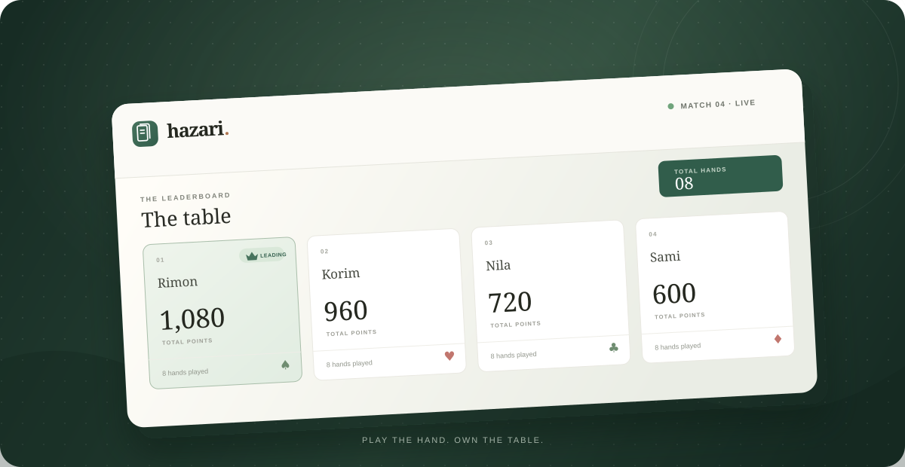

<div align="center">

# Hazari Scoreboard

### A little more clarity around the table.



**Four players · 360 points per hand · Match history that remembers the winner**

</div>

## Get started

From this folder, run:

```bash
npm install
npm run dev
```

Then open [http://localhost:3000](http://localhost:3000).

## How a hand is scored

Every hand adds up to **360 points**. Enter any three players' scores and the fourth is calculated automatically. With only two scores entered, Hazari waits for more information. If you know the other two players tied, confirm the tie; it will calculate their points only when the remainder divides evenly into whole numbers.

## Save a match

Choose **Finish match** to record the date, winner or tied winners, final totals, and all hand scores. Expand a saved match in **Match history** to review each hand. Match data stays in this browser on this device.

## Deploy to Vercel

Import the repository in Vercel and set **Root Directory** to `hazari-scoreboard`. Keep the detected Next.js framework settings; no environment variables are required.

## Production build

```bash
npm run build
npm start
```

<div align="center">

**Developed by Rimon**

</div>
